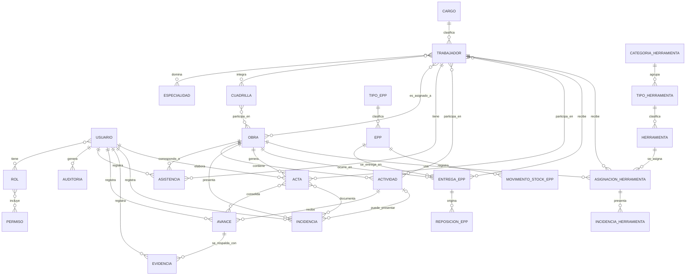
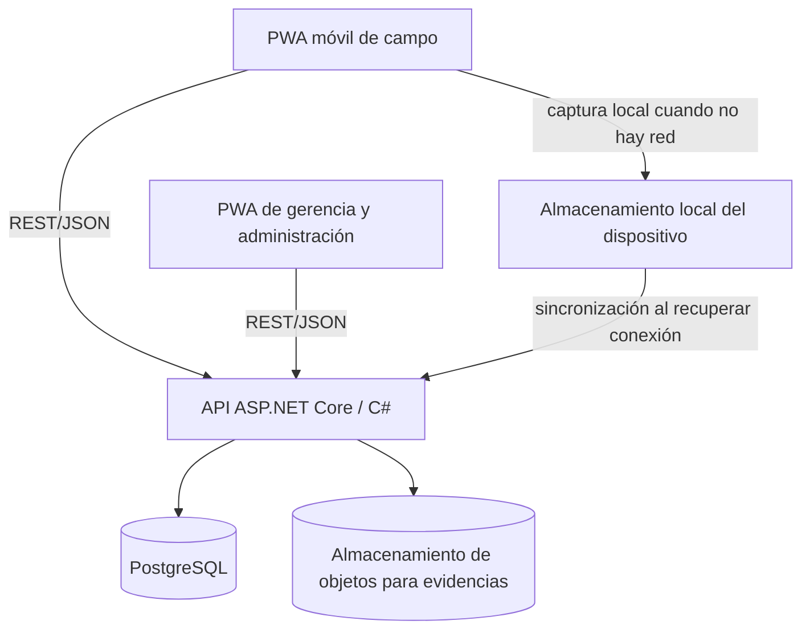

# Contexto de producto y backend — Constructora Eder Torres

**Corte del contexto:** 27 de octubre de 2026  
**Propósito:** dar a una persona desarrolladora o a una IA un contexto consolidado y trazable para iniciar el backend de la PWA de seguimiento y control operativo.  
**Estado:** contexto de trabajo con inicialización técnica del backend; no sustituye la validación formal del catálogo de requerimientos ni la conciliación del esquema PostgreSQL existente.

## Instrucciones para quien implemente

1. No convertir una propuesta del modelo ER, una estimación del Excel o una recomendación técnica en regla de negocio aprobada.
2. Mantener separados los hechos de las entrevistas, el catálogo formal de requerimientos, las decisiones posteriores del usuario y los asuntos abiertos. Las etiquetas de este documento indican esa diferencia.
3. El catálogo formal vigente en disco contiene `FRQ-0001..0023`, `CRQ-0001..0004` y `NFR-0001..0009`. FRQ-0006 ya incluye GPS y correcciones autorizadas, FRQ-0011 ya define el acta semanal y FRQ-0023 junto con NFR-0002, NFR-0005 y NFR-0008 formalizan el trabajo sin conexión y la sincronización.
4. No añadir nómina, contabilidad, impuestos, finanzas, presupuestos/facturación, compras o consumo de materiales como funcionalidades del producto actual. La asistencia puede alimentar un consolidado para nómina, pero no se calcula la nómina.
5. El ER conceptual antiguo que aparece en la sección 10 es un borrador; no confundirlo con el DDL físico PostgreSQL de 38 tablas. Antes de implementar o cambiar esquema, revisar el DDL y los pendientes de validación.
6. No se debe diseñar una tabla de llaves foráneas en el diagrama ER conceptual para resolver una relación N:N. Esa conversión corresponde al modelo relacional.
7. La versión vigente de los documentos del proyecto ya incluye FRQ-0023, GPS en asistencia, actas semanales y captura sin conexión. No presentar estas capacidades como pendientes de agregar al catálogo ni crear nuevos FRQ/CU/NFR sin autorización expresa del usuario.
8. Distinguir el modelo ER conceptual del modelo físico PostgreSQL de 38 tablas. El archivo SQL disponible no necesariamente contiene las modificaciones solicitadas después; su aplicación en la instancia activa no está confirmada.

### Etiquetas de evidencia

- **[DOCUMENTO]**: aparece en el catálogo formal, en las entrevistas o en el diagnóstico organizacional.
- **[DECISIÓN POSTERIOR]**: fue acordada en la conversación después de elaborar el catálogo formal.
- **[PROPUESTA]**: idea de diseño contenida en un borrador o sugerida para validación; no está aprobada como regla.
- **[PENDIENTE]**: falta decisión empresarial o validación de usuario.
- **[FUERA DE ALCANCE]**: tema mencionado por la empresa, pero excluido de esta versión del sistema.
- **[DECISIÓN TÉCNICA RECOMENDADA]**: orientación de arquitectura/implementación útil para el proyecto, pero no requisito funcional ni decisión aprobada por la empresa.

## 1. Fuentes revisadas y límites de lo disponible

### Fuentes funcionales y artefactos del proyecto

| Fuente disponible en el espacio de trabajo | Autoridad / uso en este contexto |
|---|---|
| `Documentacion/CORTE I/Requerimeintos Constructora Eder Torres.docx` | Catálogo formal vigente en disco: FRQ-0001..0023, CRQ-0001..0004 y NFR-0001..0009, con trazabilidad, preguntas pendientes y alcance. Aunque el nombre del archivo contiene una errata, se conserva su nombre real. |
| `Documentacion/CORTE I/Instrumentos unificados.docx` | Fuente primaria de entrevistas al Gerente General y al Ingeniero Residente. Las referencias se indican como `Gerencia P#` o `Campo P#`. |
| `Documentacion/Proyecto de Curso - Diagnóstico de la estructura organizacional.docx` | Diagnóstico de la empresa y su estructura organizacional; sirve para contexto, no define permisos de software por sí solo. |
| `Documentacion/Sistema Web para COnstructora Eder Torres.docx` y `Documentacion/FULLINFO.docx` | Entendimiento general y casos de uso CU-01..CU-23, incluidas las fichas Coleman. Cuando haya diferencias, contrastarlas con el catálogo formal vigente y anotar la discrepancia; no corregir documentos entregados sin autorización. |
| `Documentacion/CORTE I/Modelo Fisico Constructora Eder Torres.sql` | DDL disponible para el modelo físico PostgreSQL de 38 tablas. Es la referencia del esquema versionado, pero debe reconciliarse con cambios posteriores aplicados directamente a la base. |
| `Documentacion/CORTE I/Diagrama ER Constructora Eder Torres.pgerd` | Diagrama ER físico/conceptual de pgAdmin disponible para revisión. |
| `Documentacion/Diagramas/` | Diagramas de actividad, casos de uso del negocio, contenido, estados y navegacionales/UWE. Son artefactos de modelado; no prevalecen sobre los requisitos. |
| `Documentacion/Tercer corte.pdf`, `Documentacion/Segundo Corte .pdf`, `Documentacion/Sesión 28-29-30.pdf` | Instrucciones académicas y criterios de entrega/diagramación; no son por sí solos requisitos de operación del producto. |
| `Documentacion/Estudio Economico Constructora Eder Torres.xlsx` y `Documentacion/CORTE I/Estudio Economico Constructora Eder Torres Corregido.xlsx` | Estimaciones académicas. No usar hojas de puntos de función o base de datos como contrato API ni como esquema físico vigente sin verificarlas. |
| `Documentacion/Ideas de Implementación de Software.docx` | Ideas/propuestas técnicas de apoyo. No confundirlas con acuerdos obligatorios si contradicen decisiones expresas posteriores. |
| `README.md`, `ConstructoraEderTorres.sln` y `src/` | Inicialización técnica del backend en .NET 10: arquitectura por capas, configuración, diagnóstico y persistencia preparada. El código no sustituye el catálogo funcional. |

### Límites de revisión de fuentes

Los documentos revisados se encuentran en la carpeta `Documentacion` del proyecto. En esta revisión no se encontró una carpeta `upload`, `library_review` ni `project_sources`, ni el borrador `miro_er_blueprint.md` referido por una edición previa de este archivo; por tanto, esas rutas no deben usarse como referencias vigentes. Tampoco se debe afirmar que se revisaron reglamentos externos si no están presentes en el espacio de trabajo o no se consultaron expresamente.

- Ya existe una inicialización del backend en `src/`, descrita en `README.md`. Incluye diagnóstico técnico y configuración EF Core/Npgsql; todavía no implementa casos de uso de negocio, autenticación ni mapeos de las 38 tablas. No se dispone de una conexión autorizada/configurada a la instancia PostgreSQL activa para confirmar el esquema o las migraciones aplicadas.
- El usuario informó previamente que el script PostgreSQL se ejecutó satisfactoriamente y que la base ya está creada. Esa confirmación conversacional no sustituye inspeccionar el estado real de la instancia.
- El DDL disponible no refleja varios cambios solicitados después. No volver a ejecutarlo a ciegas sobre la base existente; primero conciliar esquema actual, SQL versionado y cualquier script `ALTER` que sí se haya aplicado.
- Las hojas del Excel económico son estimaciones/entregables académicos. No son fuente autoritativa para entidades, contratos API ni decisiones de persistencia.

## 2. Contexto de la empresa y del problema

- **[DOCUMENTO]** Constructora Eder Torres opera en construcción e infraestructura en Managua. El diagnóstico organizacional registra aproximadamente 43 colaboradores fijos. La entrevista de gerencia agrega personal subcontratado según proyecto y más de tres obras simultáneas. El volumen en campo varía por proyecto; se describen aproximadamente 30 personas en remodelaciones y 90–100 en construcciones desde cero (`Instrumentos unificados.docx`, Gerencia P1–P2 y Campo P1).
- **[DOCUMENTO]** Los controles actuales usan papel, hojas de cálculo y grupos de WhatsApp. Las fotografías se dispersan en chats y los documentos físicos pueden deteriorarse o perderse. Las entrevistas no describen una falla general de comunicación (`Gerencia P4, P6, P8, P10`).
- **[DOCUMENTO]** La gerencia necesita conocer diariamente el estado de las obras y comparar avance físico planificado con real. La planeación utiliza cronogramas de actividades; el diagnóstico organizacional menciona Microsoft Project.
- **[DOCUMENTO]** El avance financiero se controla por compras y facturación, pero esos procesos no forman parte de esta aplicación.
- **[DOCUMENTO]** En campo se reportan conectividad débil o casi nula dentro de locales comerciales cerrados, bodegas y turnos nocturnos (`Campo P6`).
- **[DOCUMENTO]** Las operaciones se hacen con teléfonos celulares. La lentitud es el principal motivo señalado para rechazar la aplicación (`Gerencia P35`, `Campo P13`).

## 3. Alcance del sistema

### Incluido en el catálogo formal

1. Usuarios, roles y autenticación.
2. Obras, trabajadores y asignaciones trabajador–obra.
3. Registro y consulta consolidada de asistencia.
4. Actividades, avance físico, evidencias, actas, incidencias y justificaciones.
5. Stock, entrega, reposición, historial y reportes de EPP.
6. Existencias, asignaciones, devoluciones y eventos/incidencias de herramientas.
7. Operación parcial sin conexión: guardar en el dispositivo asistencias, avances, evidencias fotográficas y movimientos de EPP/herramientas, y sincronizar automáticamente al recuperar conectividad, evitando pérdidas y duplicaciones (FRQ-0023).

### Fuera de alcance de esta versión

- Nómina, cálculo salarial y proceso de planilla.
- Declaraciones fiscales o procesos ante la DGI.
- Contabilidad, presupuestos, facturación y planificación financiera.
- Compras y consumo de materiales, inventario de materiales o control de materiales sobrantes.
- Mantenimiento de maquinaria.

El reporte de asistencia puede consultarse para el proceso de nómina (`Gerencia P20, P28`), pero no implica implementar cálculo salarial. Aunque se mencionaron materiales sobrantes e inventario de materiales (`Gerencia P36`), el propio documento de requerimientos delimita la versión actual a seguimiento, asistencia, EPP y herramientas.

## 4. Stack técnico y decisiones de producto

### Tecnologías acordadas y recomendaciones técnicas

| Capa | Tecnología / estado |
|---|---|
| Cliente | React + TypeScript en una aplicación web progresiva (PWA), priorizada para teléfonos. **[DECISIÓN POSTERIOR]** |
| Backend | API web con ASP.NET Core y C#. **[DECISIÓN POSTERIOR]** |
| Persistencia relacional | PostgreSQL. **[DECISIÓN POSTERIOR]** |
| Acceso a datos | Entity Framework Core con proveedor Npgsql para PostgreSQL. **[DECISIÓN POSTERIOR]**: el usuario confirmó su adopción al autorizar la inicialización el 27 de octubre de 2026. |
| Comunicación | REST/JSON como interfaz principal. **[DECISIÓN TÉCNICA RECOMENDADA]**; no exige WebSockets. |
| Evidencias | Almacenamiento de archivos/objetos separado de metadatos relacionales. **[PROPUESTA TÉCNICA]**; elegir proveedor y confirmar costo/retención antes de implementarlo. |
| Uso de campo sin red | Captura local y sincronización automática posterior son requisitos formales (FRQ-0023, NFR-0002, NFR-0005, NFR-0008). IndexedDB/Background Sync son opciones técnicas, no tecnologías exigidas por el catálogo. |

No se fijaron en el catálogo proveedor de nube, hosting, librería de UI, proveedor de mapas, mecanismo/protocolo de autenticación ni estrategia de CI/CD. La decisión tecnológica de trabajo es .NET 10 y Visual Studio 2026; ya se detectó el SDK 10.0.403, aunque la finalización de la instalación del IDE aún debe comprobarse en Visual Studio. Las versiones de paquetes de la inicialización están fijadas en `Directory.Packages.props`. No afirmar que Azure, JWT, Google Maps u otra opción concreta hayan sido aprobados.

### UX de campo procedente de entrevistas

**[DOCUMENTO]** La interfaz de campo debe considerar botones grandes, alto contraste bajo luz solar, registros en dos o tres toques como máximo y poca digitación en teclado móvil (`Campo P7`). La preferencia expresada es rapidez y continuidad del flujo de trabajo. Esto es contexto de diseño; no define por sí solo tecnología o criterios automáticos de aceptación.

### PWA y GPS

- **[DOCUMENTO]** El residente pidió una aplicación instalada en el dispositivo por rapidez, cámara y operación sin conexión (`Campo P12`). La PWA es la decisión técnica posterior para atender el uso móvil; no es una aplicación nativa independiente.
- **[DOCUMENTO]** El GPS y la fecha/hora se solicitaron para evidencias fotográficas, junto con la vinculación a una tarea del cronograma o acta (`Campo P9`). FRQ-0010 incluye ubicación en evidencias.
- **[DOCUMENTO]** FRQ-0006 vigente incluye coordenadas GPS al registrar entrada/salida y permite correcciones autorizadas. El actor principal especificado es el Ingeniero Residente.
- **[PENDIENTE]** El catálogo no define precisión mínima, geocerca/perímetro, conducta cuando el GPS está apagado o es impreciso, ni aprobación detallada de cada corrección. No tratar `radio_gps_permitido` del antiguo ER como regla aprobada.
- La ubicación capturada desde el teléfono del residente identifica el dispositivo desde el que se registra, no prueba por sí sola la ubicación individual de cada trabajador. Si se usa registro por cuadrilla, diseñar y validar esa limitación sin cambiar el sentido del requisito.

## 5. Catálogo funcional formal disponible

Las descripciones siguientes resumen el significado del documento formal. Los identificadores son estables y las erratas de escritura se normalizaron sin cambiar el sentido.

| ID | Función | Actor indicado en el documento | Estado/notas |
|---|---|---|---|
| FRQ-0001 | Administrar cuentas de usuario para personal autorizado. | Gerente General | Formal. |
| FRQ-0002 | Asignar permisos de acceso de acuerdo con roles definidos por la empresa. | Gerente General | Formal; permisos concretos por rol pendientes. |
| FRQ-0003 | Registrar, consultar, actualizar y cambiar estado de obras: planificada, activa, suspendida o finalizada; mantener separada la información de cada proyecto. | Gerente General | Formal. |
| FRQ-0004 | Registrar, consultar, actualizar y desactivar trabajadores. | Personal autorizado | Formal. |
| FRQ-0005 | Asignar trabajadores a una obra y conservar cuadrilla, especialidad, tipo de contratación y período de asignación. | Gerente General o personal autorizado | Formal. |
| FRQ-0006 | Registrar entrada/salida del personal operativo con trabajador, obra, fecha/hora y coordenadas GPS al momento del registro; permitir correcciones autorizadas. | Ingeniero Residente | Formal vigente. La política de autorización y el comportamiento de GPS impreciso siguen por definir. |
| FRQ-0007 | Generar consolidado de asistencia filtrado por obra, trabajador, período y cuadrilla. | Ingeniero Residente | Formal. No es nómina. |
| FRQ-0008 | Registrar y consultar actividades de obra como referencia para seguimiento del avance, con unidad, cantidad planificada, responsable y participantes. | Personal autorizado | Formal. |
| FRQ-0009 | Registrar avance físico diario y semanal de cada obra asociado a actividades. | Ingeniero Residente | Formal. |
| FRQ-0010 | Adjuntar fotografías, bitácoras, fecha, hora, obra, actividad, ubicación y otras evidencias de avance. | Ingeniero Residente | Formal. La entrevista pide GPS/fecha/hora en la evidencia. |
| FRQ-0011 | Elaborar acta semanal por obra que consolide actividades/avances del período, evidencias, incidencias, justificaciones de retrasos, observaciones, mejoras, solicitudes de actividades no contratadas, participantes y constancia de aprobación. | Ingeniero Residente | Formal vigente; el contenido de firma/aprobación y el cierre aún deben alinearse con CU-11. |
| FRQ-0012 | Registrar incidencias que afecten una actividad o el cronograma de una obra. | Ingeniero Residente | Formal. |
| FRQ-0013 | Exigir motivo/circunstancia al marcar una actividad incompleta o retrasada. | Ingeniero Residente | Formal; también CRQ-0001. |
| FRQ-0014 | Registrar entradas autorizadas de EPP, consultar cantidades disponibles por tipo y actualizar existencias por entrega/reposición; mantener condiciones: disponible, entregado, dañado, perdido, en revisión, retirado. | Supervisor de Higiene y Seguridad | Formal. |
| FRQ-0015 | Registrar entrega de EPP indicando trabajador, tipo, fecha y obra. | Supervisor de Higiene y Seguridad | Formal. |
| FRQ-0016 | Registrar reposición por daño, pérdida o desgaste, incluyendo devolución/comprobación cuando corresponda. | Supervisor de Higiene y Seguridad | Formal. |
| FRQ-0017 | Consultar historial por trabajador: entregas, devoluciones, daños, pérdidas y reposiciones. | Supervisor de Higiene / Gerente General | Formal. |
| FRQ-0018 | Generar reportes de cantidad y tipo de EPP entregado por trabajador y obra. | Gerente General | Formal. |
| FRQ-0019 | Mantener un registro actualizado de herramientas disponibles para asignación a distintas obras. | Responsable autorizado | Formal. La conversación posterior descarta un ledger separado de movimientos de stock. |
| FRQ-0020 | Registrar asignación/entrega de herramienta con responsable, obra, fecha y herramienta. | Responsable autorizado | Formal. |
| FRQ-0021 | Registrar pérdidas, devoluciones o incidencias de herramientas entregadas. | Responsable autorizado / Gerente General | Formal. |
| FRQ-0022 | Autenticar usuarios con credenciales y habilitar funciones correspondientes al rol. | Usuario autorizado | Formal; CU-22 describe usuario/clave y sesión activa. La estrategia de sesión/expiración no está detallada. |
| FRQ-0023 | Guardar temporalmente en el dispositivo asistencia, avances, evidencias fotográficas y movimientos de EPP/herramientas sin conexión, y sincronizarlos automáticamente al volver la conectividad, sin pérdida ni duplicación. | Personal autorizado en campo | Formal vigente; el diseño de conflictos, reintentos y capacidad local se concreta técnicamente. |

### Decisiones y actualizaciones ya reflejadas en los documentos vigentes

- **Acta semanal:** FRQ-0011 y CU-11 ya especifican un acta semanal por obra que consolida actividades, avances, evidencias, incidencias y demás datos de seguimiento. No crear un requisito adicional de reporte diario; los reportes existentes de asistencia/EPP siguen siendo capacidades distintas.
- **GPS y correcciones de asistencia:** FRQ-0006 y CU-06 ya incluyen GPS y correcciones autorizadas. El rol principal indicado es el Ingeniero Residente; no inferir auto-registro individual de cada albañil.
- **Sin conexión/sincronización:** FRQ-0023 y CU-23 ya cubren asistencia, avances, evidencias fotográficas y movimientos de EPP/herramientas. NFR-0002 establece guardado local de fotografía en hasta 2 segundos y envío posterior; NFR-0005 y NFR-0008 cubren operación bajo conectividad insuficiente e integridad durante sincronización.
- **Correcciones de asistencia:** están dentro de FRQ-0006/CU-06; no crear un FRQ separado.
- **Herramientas:** no se ha aprobado una tabla autónoma de movimientos de stock. El DDL controla cada herramienta individual por código/estado, con asignaciones e incidencias/devoluciones.
- **Congelamiento del alcance:** el usuario indicó que los requerimientos/casos ya entregados no deben ampliarse sin autorización. Tratar la versión actual en disco como baseline y documentar dudas como aclaraciones técnicas, no convertirlas en nuevos FRQ/CU/NFR.

## 6. Reglas de dominio formalmente documentadas

| ID | Regla | Base/estado |
|---|---|---|
| CRQ-0001 | Una actividad incompleta o retrasada debe tener justificación antes de finalizar su registro. Ejemplos: lluvia, demora de importación u otra circunstancia del cronograma. | Derivada de entrevista de gerencia; la existencia del motivo obligatorio es formal. |
| CRQ-0002 | En reposición de EPP por daño se debe registrar la entrega o comprobación del equipo dañado antes o durante la entrega del nuevo, cuando corresponda. | Derivada del procedimiento descrito por el usuario de campo. |
| CRQ-0003 | Los registros operativos que correspondan a una obra deben quedar asociados a la obra correcta, incluyendo asistencia, avance, incidencias, EPP y herramientas. | Derivada por análisis del contexto multiobra; formalmente pendiente de validación empresarial. |
| CRQ-0004 | Las entregas/reposiciones de EPP usan inventario autorizado por Gerencia General; Higiene y Seguridad autorizado realiza la entrega física y el registro. | Derivada de entrevista gerencial. |

### Reglas y políticas de EPP en el documento conceptual anterior

Estas precisiones aparecen en `Contexto Maestro`, pero no todas están incluidas en el catálogo formal actual:

- Los tipos de EPP deberían ser configurables; la lista de botas, cascos, guantes, chalecos, gafas, arneses u otros son ejemplos, no catálogo aprobado.
- Los períodos de reposición se describen como parámetros administrativos de la empresa, no como estándar universal. El ejemplo de botas por seis meses es ilustrativo, no un valor confirmado.
- El documento recomienda no bloquear automáticamente un reemplazo anticipado por período si el equipo está dañado, deteriorado, inseguro, perdido o defectuoso. Plantea registrar motivo, observaciones, evidencia cuando proceda, revisión y resultado. Esto requiere aprobación explícita antes de implementarlo.
- El historial de entregas debe conservar trazabilidad y no sobrescribir eventos previos. Es una recomendación del contexto conceptual alineada con `FRQ-0017`.
- `Solicitud_EPP`, `Inspeccion_EPP` y sus detalles aparecen en el documento conceptual anterior, pero no son entidades/requerimientos confirmados en el catálogo actual. No agregarlos sin validación.

## 7. Requerimientos no funcionales formales

Los valores cuantitativos de rendimiento fueron definidos preliminarmente por el equipo y el propio documento exige validarlos; no son SLA aprobados.

| ID | Requerimiento | Importancia / condición |
|---|---|---|
| NFR-0001 | Respuesta máxima de 3 segundos bajo redes 3G. | Vital; métrica y condiciones deben validarse. |
| NFR-0002 | Guardar fotografías localmente en un máximo de 2 segundos; el envío al servidor puede ocurrir posteriormente mediante sincronización al recuperar conectividad. | Alta. El límite de 2 s corresponde al guardado local, no al upload remoto. |
| NFR-0003 | Funciones utilizadas en campo disponibles correctamente desde teléfonos celulares. | Alta. |
| NFR-0004 | Diseño adaptable a diferentes tamaños de pantalla sin perder funciones ni información necesaria. | Alta. |
| NFR-0005 | Las funciones de campo operan mediante datos móviles y permiten captura temporal cuando la conexión es insuficiente o inexistente. | Alta; la sincronización se describe en FRQ-0023/CU-23. |
| NFR-0006 | Restringir funciones y datos según rol asignado. | Alta; matriz detallada de permisos pendiente. |
| NFR-0007 | Trazar creación, modificación y anulación de registros críticos, usuario responsable y fecha/hora. | Alta; definir registros críticos, conservación y quién puede consultar auditoría. |
| NFR-0008 | Preservar consistencia entre obras, trabajadores, actividades, asistencias, movimientos de EPP/herramientas; durante la sincronización evitar pérdida, duplicación o asociación incorrecta. | Alta; exige validación de integridad en servidor y diseño idempotente de sincronización. |
| NFR-0009 | Interfaz de campo simple, consistente y de pocas interacciones, sin navegación innecesaria. | Alta; entrevista añade botones grandes, alto contraste, máximo 2–3 toques y poca digitación como dirección de diseño. |

## 8. Actores, cargos y acceso

Los cargos de la empresa y los roles del software son conceptos distintos. La lista de cargos viene del diagnóstico/entrevistas; la matriz de permisos de la aplicación sigue sin aprobación.

| Actor/cargo de negocio | Responsabilidades o acceso expresado en fuentes | Grado de certeza |
|---|---|---|
| Gerente General | Supervisión estratégica; autoriza compras/reposiciones de inventario EPP; consulta reportes; acceso a todas las obras. | Entrevistas. |
| Gerente(s) de Operaciones | Coordinación y seguimiento; acceso a todas las obras según Gerencia P30. | Entrevistas; funciones CRUD exactas pendientes. |
| Ingeniero Residente | Seguimiento diario, lista/asistencia de cuadrilla, actividades, evidencias, actas e incidencias; limitado a obras asignadas. | Entrevistas y FRQ; permisos exactos pendientes. |
| Supervisor de Higiene y Seguridad | Entrega y control directo de EPP; registra entregas/reposiciones. | Entrevista y FRQ-0014–0017. |
| Responsable Administrativo/Contador | Gerencia indica que consulta asistencia para planilla. No se implementa cálculo de nómina. | Entrevista; rol técnico y permisos pendientes. |
| Trabajador/albañil/ayudante | No debe consultar datos de otros trabajadores, según entrevista. No está confirmado que tenga cuenta o use directamente la aplicación. | Ver conflicto abierto. |
| Responsable autorizado de herramientas | Opera inventario y asignaciones según FRQ-0019–0021. Identidad/cargo no definido. | Pendiente. |

**Cuentas y marcación:** el documento conceptual anterior propone cuentas individuales para albañiles y que ellos registren entrada/salida y consulten EPP. La entrevista de gerencia afirma que los albañiles no interactúan con el software y que el residente valida su cuadrilla; `CU-06` define el registro desde una lista agrupada por cuadrilla/especialidad con casillas de selección rápida. El catálogo formal asigna `FRQ-0006` al Ingeniero Residente, por lo que el actor está definido. Sigue sin estar aprobado el autoservicio/cuenta del trabajador. Para la selección rápida, falta aclarar cómo se asocia la lectura GPS a cada marcación seleccionada.

**GPS y actor:** si el residente registra a toda una cuadrilla desde su propio teléfono, el GPS solo ubica ese dispositivo; no acredita por sí solo la ubicación individual de cada trabajador. Es una implicación técnica que debe resolverse al validar el flujo, no una regla documentada.

## 9. Flujos de negocio conocidos

### Asistencia

1. La asistencia se registra actualmente en papel con entrada y salida.
2. Entrada y salida deben quedar vinculadas a una sola jornada aunque un turno nocturno termine al día siguiente (`Gerencia P18–P22`). El DDL usa instantes con zona horaria y una fecha de jornada.
3. En campo prefieren una lista predefinida agrupada por cuadrilla y especialidad con casillas de verificación rápida (`Campo P8`).
4. El actor formal de registro es el Ingeniero Residente; CU-06 describe selección de trabajadores y registro de entrada/salida.
5. FRQ-0006 exige guardar coordenadas GPS al momento de la marcación y permite correcciones autorizadas. Aún faltan detalles de precisión, geocerca y aprobación.
6. FRQ-0007 requiere consolidado filtrable por obra, trabajador, período y cuadrilla; el dato puede apoyar nómina, pero el sistema no calcula planilla.

### Seguimiento de obras

1. Las obras tienen actividades y cronograma planificado.
2. El residente registra avance físico diario/semanal por actividad.
3. Evidencias pueden ser fotografías, bitácoras y actas semanales; una foto debe asociarse a obra/actividad y contener fecha/hora/GPS como información solicitada en campo.
4. Se registran incidencias que expliquen afectación del trabajo/cronograma, por ejemplo lluvia o demora de elementos importados. Esto no implica compras o inventario de materiales.
5. Las actividades incompletas/retrasadas requieren motivo (`FRQ-0013`, `CRQ-0001`).
6. **[DOCUMENTO]** FRQ-0011/CU-11 requieren un acta semanal por obra que consolide actividades, avances, evidencias, incidencias, justificaciones y demás campos especificados. No crear una función separada de reporte diario de actividades.

### EPP

1. Gerencia autoriza compras/reposiciones del inventario general; Higiene y Seguridad realiza entrega física y registro.
2. Se registra tipo de EPP, trabajador, fecha y obra; el sistema controla existencias por tipo y condición.
3. En daño o pérdida el procedimiento actual contempla entregar el equipo dañado cuando corresponda, recibir el nuevo y firmar control.
4. El historial debe permitir saber quién recibió qué y cuándo, incluyendo devoluciones, daños, pérdidas y reposiciones.
5. El documento conceptual plantea anticipación y solicitudes, pero su ciclo completo aún no es parte de los RF formales.

### Herramientas

1. La organización reportó pérdidas frecuentes y falta de rastreo.
2. El catálogo formal pide inventario disponible, asignación a persona/obra y registro de devolución, pérdida o incidencia.
3. **[DECISIÓN POSTERIOR]** El control es de herramientas físicas individualizables (por ejemplo, cada taladro con código), con asignaciones/devoluciones e incidencias. No añadir un módulo/entidad independiente de movimientos de stock de herramientas.
4. La forma exacta de representar compra/alta, traslado, reparación, mantenimiento y baja no está definida en el catálogo; no agregarlos como transacciones sin validar.

### Operación sin conexión

1. Gerencia solicita recolección en campo sin conexión y sincronización al recuperar cobertura (`Gerencia P34`).
2. El usuario de campo solicita guardar localmente fotos, asistencias y entregas de EPP y sincronizarlas automáticamente en segundo plano (`Campo P10`).
3. FRQ-0023/CU-23 vigentes amplían formalmente el alcance offline a asistencias, avances, evidencias fotográficas y movimientos de EPP/herramientas.
4. El registro local debe hacerse en menos de 2 segundos para fotografías (NFR-0002); la sincronización automática no debe causar pérdida, duplicación ni asociación incorrecta (NFR-0008).
5. La capacidad máxima local, política de conflicto, tratamiento de dispositivo perdido, caducidad de registros pendientes y manejo al expirar la sesión siguen pendientes de decisión técnica/validación.
6. No contar la cola local como entidad de negocio del ER. Su almacenamiento/sincronización es implementación; los registros operativos válidos llegan a PostgreSQL.

## 10. Modelo de datos: conceptual y físico

El diagrama de 25 entidades que aparece a continuación es un borrador conceptual anterior, no un esquema aprobado ni la lista de tablas que se debe implementar hoy. El modelo físico disponible en `Documentacion/CORTE I/Modelo Fisico Constructora Eder Torres.sql` define 38 tablas PostgreSQL y es la referencia versionada para persistencia, sujeta a reconciliar los cambios aplicados después en la instancia activa. Para el ER conceptual académico se usa un diagrama unificado, sin tablas puente para resolver N:N; en el modelo relacional/físico sí se emplean tablas asociativas.

### Diagrama unificado de relaciones candidatas

El siguiente ER es una vista textual compacta de las relaciones candidatas. Mermaid no representa los óvalos y diamantes de Chen; por eso no sustituye el dibujo visual del tablero. Las cardinalidades de negocio deben contrastarse con las reglas de asignación, vigencia y control de inventario; las conexiones entre usuario registrador y sus acciones reflejan los actores especificados en FRQ/CU.



**Advertencias sobre el diagrama:**

- `TRABAJADOR–ASISTENCIA` expresa a quién corresponde la asistencia; `USUARIO–ASISTENCIA` expresa quién la registra. FRQ-0006/CU-06 asignan el registro al Ingeniero Residente. El DDL versionado ya incluye `id_usuario_registro` en asistencias; cotejar este vínculo con la instancia activa.
- FRQ-0009 asigna el registro de avances y FRQ-0011 la elaboración del acta al Ingeniero Residente. El DDL versionado registra la cuenta creadora de avances, evidencias, incidencias y actas; participantes del acta son una relación diferente. Revisar las cardinalidades de cada vínculo en el diagrama aprobado y CU-11.
- `CUADRILLA–OBRA` y `TRABAJADOR–OBRA` tienen períodos/historial propuestos. El contexto anterior señala que falta confirmar asignaciones simultáneas a más de una obra.
- El usuario decidió mantener las N:N en el conceptual. En el relacional se resolverán con tablas asociativas donde corresponda.
- La entidad `EPP` como unidad física individual y `MOVIMIENTO_STOCK_EPP` deben contrastarse con cómo la empresa controla consumibles por cantidad y elementos identificados individualmente.
- No crear `MOVIMIENTO_STOCK_HERRAMIENTA` como entidad independiente: contradice la decisión posterior del usuario.

### Entidades y atributos candidatos del borrador conceptual anterior — no implementar directamente

Los atributos son candidatos a validar, no un contrato de API ni migraciones listas para aplicar.

| Entidad | PK propuesta | Otros atributos propuestos |
|---|---|---|
| Usuario | `id_usuario` | `nombre_usuario`, `contrasena_hash`, `estado`, `ultimo_acceso` |
| Rol | `id_rol` | `nombre`, `descripcion`, `estado` |
| Permiso | `id_permiso` | `nombre`, `descripcion`, `modulo` |
| Auditoria | `id_auditoria` | `accion`, `entidad_afectada`, `identificador_registro`, `fecha_hora`, `valor_anterior`, `valor_nuevo` |
| Obra | `id_obra` | `nombre`, `descripcion`, `direccion`, `fecha_inicio_planificada`, `fecha_fin_planificada`, `estado`, `latitud`, `longitud`, `radio_gps_permitido` |
| Trabajador | `id_trabajador` | `cedula`, `nombres`, `apellidos`, `telefono`, `fecha_ingreso`, `estado` |
| Cargo | `id_cargo` | `nombre`, `descripcion` |
| Cuadrilla | `id_cuadrilla` | `nombre`, `descripcion`, `estado` |
| Especialidad | `id_especialidad` | `nombre`, `descripcion` |
| Asistencia | `id_asistencia` | `fecha`, `hora_entrada`, `hora_salida`, `latitud_entrada`, `longitud_entrada`, `latitud_salida`, `longitud_salida`, `precision_gps`, `estado_validacion` |
| Actividad | `id_actividad` | `nombre`, `descripcion`, `unidad_medida`, `cantidad_planificada`, `fecha_inicio_planificada`, `fecha_fin_planificada`, `estado` |
| Avance | `id_avance` | `fecha`, `cantidad_ejecutada`, `porcentaje_avance`, `periodicidad`, `observacion` |
| Evidencia | `id_evidencia` | `tipo`, `archivo_url`, `fecha_hora`, `latitud`, `longitud`, `descripcion` |
| Incidencia | `id_incidencia` | `tipo`, `descripcion`, `fecha_hora`, `impacto`, `estado`, `justificacion` |
| Acta | `id_acta` | `numero`, `fecha_inicio_periodo`, `fecha_fin_periodo`, `fecha_emision`, `observaciones`, `mejoras_propuestas`, `solicitudes_no_contratadas`, `estado_aprobacion`, `constancia_firma` |
| Tipo_EPP | `id_tipo_epp` | `nombre`, `descripcion`, `vida_util_meses`, `stock_minimo`, `tipo_control` |
| EPP | `id_epp` | `codigo_inventario`, `talla`, `fecha_adquisicion`, `condicion`, `estado` |
| Entrega_EPP | `id_entrega_epp` | `fecha_hora`, `cantidad`, `condicion_entrega`, `constancia_firma`, `observacion` |
| Reposicion_EPP | `id_reposicion_epp` | `fecha_hora`, `motivo`, `condicion_equipo_anterior`, `comprobacion_devolucion`, `autorizada`, `observacion` |
| Movimiento_Stock_EPP | `id_movimiento_epp` | `fecha_hora`, `tipo_movimiento`, `cantidad`, `motivo`, `saldo_resultante`, `autorizado` |
| Categoria_Herramienta | `id_categoria_herramienta` | `nombre`, `descripcion` |
| Tipo_Herramienta | `id_tipo_herramienta` | `nombre`, `descripcion`, `requiere_devolucion` |
| Herramienta | `id_herramienta` | `codigo_inventario`, `marca`, `modelo`, `numero_serie`, `fecha_adquisicion`, `condicion`, `estado` |
| Asignacion_Herramienta | `id_asignacion_herramienta` | `fecha_hora_entrega`, `fecha_prevista_devolucion`, `fecha_hora_devolucion`, `condicion_entrega`, `condicion_devolucion`, `estado`, `observacion` |
| Incidencia_Herramienta | `id_incidencia_herramienta` | `tipo`, `fecha_hora`, `descripcion`, `estado`, `accion_tomada` |

### Aspectos del modelo aún por validar

1. Si los trabajadores tendrán cuenta o solo habrá cuentas de personal autorizado. Las fuentes no confirman autoservicio del trabajador y `FRQ-0006`/`CU-06` asignan el registro de asistencia al residente. El DDL modela vínculo opcional único Usuario–Trabajador, lo cual no prueba que cada trabajador deba tener cuenta.
2. Si una asistencia representa una jornada con entrada/salida o si habrá múltiples eventos por jornada. El DDL vigente usa una fila por marcación/jornada, con fecha_jornada y entrada_at/salida_at, y debe probar turnos nocturnos.
3. Cómo tratar GPS ausente/impreciso/fuera de obra y qué precisión/geocerca se acepta; el actor especificado es Ingeniero Residente, pero la validación espacial no está detallada.
4. Si `Cuadrilla` tiene vigencia por obra/periodo y cómo se relaciona con la especialidad, puesto (`Cargo`) y asignación del trabajador.
5. Si un tipo de EPP se controla por unidad física o cantidad; el blueprint propone ambos mediante `EPP` y `tipo_control`, pero falta aprobación.
6. Solicitudes e inspecciones de EPP no están en los RF/CU vigentes; mantenerlas fuera de esta versión salvo autorización futura.
7. FRQ-0011 ya define acta semanal y el DDL relaciona actas con avances/incidencias/participantes/aprobaciones; faltan detalles de firmantes, evidencia de firma y reglas de cierre.
8. Si `unidad_medida` se almacena como texto/código o catálogo independiente. No aparece `Unidad_Medida` en el blueprint final de 25 entidades.
9. Qué operaciones de herramienta se consideran devolución normal, incidencia, reparación o baja.
10. Atributos obligatorios, nulabilidad, claves candidatas/únicas, borrado lógico y retención de evidencia/auditoría.

### Modelo físico PostgreSQL disponible: 38 tablas

El DDL versionado organiza las tablas por capacidad. El conteo se verificó leyendo las sentencias `CREATE TABLE` del archivo SQL disponible:

| Área | Tablas definidas |
|---|---|
| Seguridad y acceso | `usuarios`, `roles`, `permisos`, `usuarios_rol`, `roles_permiso`, `auditorias` |
| Catálogos, obras y personal | `cargos`, `especialidades`, `trabajadores`, `obras`, `cuadrillas`, `trabajadores_especialidad`, `asignaciones_trabajador_obra`, `cuadrillas_obra`, `trabajadores_cuadrilla` |
| Asistencia | `asistencias`, `correcciones_asistencia` |
| Seguimiento de obra | `actividades`, `trabajadores_actividad`, `avances`, `evidencias`, `incidencias`, `actividades_incidencia`, `actas`, `actas_avance`, `actas_incidencia`, `trabajadores_acta`, `aprobaciones_acta` |
| EPP | `tipos_epp`, `epps`, `entregas_epp`, `reposiciones_epp`, `movimientos_stock_epp` |
| Herramientas | `categorias_herramienta`, `tipos_herramienta`, `herramientas`, `asignaciones_herramienta`, `incidencias_herramienta` |

**Notas de diseño:** las relaciones N:N se resuelven en el modelo físico mediante tablas asociativas; `asignaciones_trabajador_obra` registra el período/tipo de contratación y sirve como contexto para varios registros operativos; EPP y herramientas se individualizan por registro y código de inventario. Si la empresa maneja EPP consumible por cantidades agregadas, se debe validar si el esquema individual actual representa el proceso correctamente.

**3FN:** el modelo pretende separar catálogos, entidades principales, eventos y asociaciones, pero el número de tablas no demuestra por sí mismo que todo el esquema cumpla 3FN. Antes de declararlo formalmente validado se debe revisar cada relación y sus dependencias funcionales, además de las reglas de unicidad, temporalidad e integridad.

**Desfase del DDL respecto a cambios conversados:**

- El DDL disponible para `incidencias_herramienta` no declara una columna `estado`, aunque después el usuario solicitó agregarla a la base.
- El archivo tampoco muestra las restricciones/funciones que impidan relaciones cruzadas entre obras. En particular, una FK simple en `trabajadores_cuadrilla`, `trabajadores_actividad`, `actividades_incidencia`, `actas_avance`, `actas_incidencia` y `trabajadores_acta` no garantiza por sí sola que ambos lados pertenezcan a la misma obra.
- El usuario solicitó scripts para cambios posteriores, pero no confirmó aquí la ejecución de esos cambios. No se dispone de una conexión a la base activa ni de un script de migración consolidado para confirmar el estado final.
- Antes de nuevos cambios, extraer/comparar el esquema real de PostgreSQL, actualizar el DDL canónico o las migraciones versionadas y probar restricciones válidas e inválidas. No ejecutar nuevamente el script inicial sin revisar el estado y el efecto sobre los datos.

## 11. Mapeo funcional a módulos lógicos

Estos módulos son agrupaciones del catálogo formal; no implican límites de servicio separados ni microservicios.

| Módulo lógico | Requerimientos |
|---|---|
| Administración y seguridad | FRQ-0001, FRQ-0002, FRQ-0022, NFR-0006, NFR-0007 |
| Obras y personal | FRQ-0003–FRQ-0005, CRQ-0003 |
| Asistencia | FRQ-0006–FRQ-0007; incluye GPS y correcciones autorizadas en FRQ-0006 |
| Seguimiento de obra | FRQ-0008–FRQ-0013, CRQ-0001; actas semanales en FRQ-0011 |
| EPP | FRQ-0014–FRQ-0018, CRQ-0002, CRQ-0004 |
| Herramientas | FRQ-0019–FRQ-0021 |
| Sincronización en campo | FRQ-0023, NFR-0002, NFR-0005, NFR-0008; capacidad técnica transversal, no microservicio/entidad de negocio |

## 12. Arquitectura lógica de referencia

La arquitectura siguiente traduce las decisiones de stack y organiza el flujo de información. Es una vista lógica, no una decisión de nube/despliegue ni un diagrama de infraestructura aprobado. La PWA puede mostrar pantallas distintas por rol dentro de una misma aplicación adaptable; no se ha decidido mantener dos aplicaciones frontend separadas.



**Implicaciones de diseño por validar:** identidad/credenciales, permisos por obra y rol, modelo de captura local, sincronización y resolución de conflictos, límites de archivos, política de borrado/retención y proveedor de almacenamiento. No fijar rutas, payloads, claves de idempotencia ni tecnología de infraestructura sin decisión técnica del proyecto.

### Arquitectura de backend adoptada

**[DECISIÓN POSTERIOR]** El usuario confirmó un monolito modular por capas al autorizar la inicialización del backend. Se despliega como una sola API y organiza internamente las capacidades del negocio por casos de uso. DDD selectivo y CQRS ligero siguen siendo orientaciones para los casos que lo justifiquen; esta inicialización no incorpora buses, mediadores ni microservicios.

| Área | Responsabilidad recomendada |
|---|---|
| Presentación/API | HTTP, autenticación/autorización, contratos de solicitud/respuesta, validación de entrada, estado HTTP y documentación OpenAPI; endpoints delgados. |
| Aplicación/Casos de uso | Orquestación de comandos/consultas, autorización por operación/obra, transacciones y coordinación entre módulos. |
| Dominio | Entidades, objetos de valor y reglas invariantes propias del negocio; sin dependencia de PostgreSQL, React ni transporte HTTP. |
| Infraestructura | PostgreSQL/EF Core/Npgsql, almacenamiento de evidencias, auditoría técnica, correo/servicios externos si se aprueban, configuración y adaptadores. |
| Pruebas | Unitarias de reglas, integración con PostgreSQL, autorización multiobra, sincronización/idempotencia y pruebas de extremo a extremo de flujos críticos. |

El límite de módulo es lógico, no una base de datos o servicio distinto. Mantener transacciones ACID en PostgreSQL para operaciones atómicas; aplicar restricciones de base de datos además de validación de aplicación. Los comandos/consultas son mecanismos internos, no requisitos funcionales adicionales.

## 13. Seguridad, integridad y auditoría

### Requisitos de seguridad documentados

- FRQ-0022 exige autenticación por credenciales. CU-22 describe usuario y clave, carga de permisos/obras asignadas y una sesión activa. El tipo de cookie/token, vencimiento, renovación y revocación no están especificados como decisión formal.
- Autorización basada en roles (`FRQ-0002`, `NFR-0006`). Las reglas de acceso a obras están expresadas en entrevistas: Gerencia General y Gerencia de Operaciones acceden a todas; residentes solo a obras asignadas (`Gerencia P30–P31`).
- La gerencia considera fundamental registrar quién creó, modificó o aprobó información importante (`Gerencia P33`); el requisito formal rastrea altas, cambios y anulaciones de registros críticos (`NFR-0007`).
- El sistema debe conservar integridad entre obra, trabajador, actividad, asistencia, EPP y herramientas (`NFR-0008`, `CRQ-0003`).
- La entrevista establece que trabajadores/albañiles no interactúan directamente con el software ni consultan datos de otros (`Gerencia P32`); CU-22 enumera perfiles autorizados, sin un rol de autoservicio de trabajador.

### Controles que el proyecto aún no ha definido

Política de contraseñas, expiración de sesión, MFA, recuperación, cifrado en tránsito/reposo, rate limits, bloqueo por intentos, auditoría de lectura, retención de logs, backups/RPO/RTO, tratamiento de dispositivos perdidos y protección de datos personales. Son decisiones de diseño/seguridad pendientes, no requisitos extraídos de los documentos.

## 14. Trazabilidad y criterios de prueba candidatos

Los casos siguientes son traducciones de los requisitos y entrevistas a pruebas de backend; no agregan funcionalidad nueva.

| Área | Prueba candidata | Base |
|---|---|---|
| Acceso a obras | Un residente asignado consulta/registra en sus obras; no obtiene registros de obras ajenas. Gerencia General y Operaciones pueden consultar todas. | Gerencia P30–P31; NFR-0006. |
| Roles | Una operación no autorizada por rol es rechazada y no modifica datos. | FRQ-0002, NFR-0006; matriz detallada pendiente. |
| Auditoría | Alta, modificación y anulación de registro definido como crítico conservan actor y fecha/hora. | NFR-0007; lista de registros críticos pendiente. |
| Integridad multiobra | Rechazar asociaciones inválidas entre registro operativo, obra, trabajador y actividad. | CRQ-0003, NFR-0008. |
| Asistencia nocturna | Una entrada en una fecha y salida al día siguiente quedan vinculadas a la misma jornada prevista por el proceso. | Gerencia P22. El diseño de jornada/eventos debe confirmarse. |
| Asistencia por lista | Probar que el Ingeniero Residente marca asistencia en la lista por cuadrilla/especialidad y que cada registro conserva trabajador, obra, fecha/hora y coordenadas; acordar cómo se vincula el punto GPS cuando se marcan varias casillas. | FRQ-0006/CU-06 y Campo P8; actor y lista con casillas definidos, asociación del GPS en selección múltiple por precisar. |
| GPS | Verificar que FRQ-0006 guarde coordenadas/fecha/hora al registrar asistencia; probar GPS apagado/impreciso/fuera de obra conforme se definan mensajes y reglas de validación. | FRQ-0006; precisión y geocerca pendientes. |
| Avance y justificación | Registro de actividad incompleta/retrasada sin motivo no se completa. | FRQ-0013, CRQ-0001. |
| Evidencia | Evidencia conserva relación con avance/obra/actividad y metadatos definidos; probar guardado local de fotografía en ≤2 s. El envío remoto puede completarse más tarde. | FRQ-0010, NFR-0002, FRQ-0023; GPS/foto en Campo P9. |
| Acta semanal | Verificar que cada acta corresponde a una obra/período semanal y consolida avances, evidencias, incidencias, justificaciones, participantes y aprobación definida. | FRQ-0011, CU-11. |
| EPP | Entrada, entrega y reposición actualizan existencias; historial permite reconstruir movimientos sin sobrescribir eventos anteriores. | FRQ-0014–0017; el detalle del ledger debe confirmarse. |
| Autorización EPP | La entrega/registro la ejecuta responsable autorizado y el inventario se encuentra bajo autorización de gerencia. | CRQ-0004. |
| Reposición por daño | Aplicar comprobación/devolución del equipo anterior cuando corresponda. | FRQ-0016, CRQ-0002. |
| Herramientas | Una herramienta asignada no aparece simultáneamente disponible; devolución/incidencia actualiza su condición según regla aprobada. | FRQ-0019–0021; semántica exacta de estados pendiente. |
| Sin conexión | Capturar asistencia, avances, fotos y movimientos de EPP/herramientas sin red; restaurar conexión, reintentar cortes parciales y comprobar idempotencia, orden y asociaciones correctas. | FRQ-0023, CU-23, NFR-0005/NFR-0008, Gerencia P34, Campo P10. |
| Rendimiento | Medir acciones frecuentes bajo redes y dispositivos representativos; no usar los 3 s/2 s como SLA definitivo hasta validación. | NFR-0001–0002. |

## 15. Preguntas abiertas que afectan decisiones de backend

GPS en asistencia, acta semanal y captura offline **ya están en los requerimientos**; no son asuntos pendientes de aprobación ni funcionalidades que falten en el catálogo. Lo que sigue son aclaraciones para que el diseño y las pruebas reflejen el proceso real. Algunas requieren validación empresarial y otras son decisiones técnicas del equipo; no todas bloquean iniciar el backend.

| Área | Asunto por aclarar | Tipo de decisión |
|---|---|---|
| Asistencia y GPS | `FRQ-0006`/`CU-06` asignan el registro al Ingeniero Residente y CU-06 describe una lista agrupada con casillas rápidas. Definir si una selección múltiple comparte una misma lectura GPS o si cada evento debe obtener una lectura propia; acordar precisión/geocerca y qué ocurre con permiso denegado, posición imprecisa, GPS apagado o punto fuera de obra. | Validación operativa y de seguridad. |
| Correcciones de asistencia | Determinar quién solicita/aprueba una corrección, qué campos se pueden cambiar, qué justificación/evidencia exige y qué eventos quedan en auditoría. | Validación de negocio y permisos. |
| Cuentas, roles y sesiones | Aprobar matriz detallada de permisos y si los trabajadores tendrán cuentas. Definir duración/inactividad, revocación, cierre, recuperación y qué ocurre con una cola offline si vence la sesión. | Validación de responsables; luego decisión de implementación. |
| Asignaciones y turnos | Confirmar si un trabajador puede estar simultáneamente asignado a varias obras/cuadrillas, cómo rigen cambios de asignación y qué zona horaria/fecha de jornada aplica a turnos nocturnos. | Validación operativa. |
| Acta semanal | La periodicidad semanal y los contenidos principales ya están definidos en `FRQ-0011`; falta cerrar estados, quién aprueba/firma y cómo se representa la constancia de aprobación. | Validación de negocio. |
| Sincronización offline | El alcance formal incluye asistencias, avances, fotos y movimientos de EPP/herramientas. Definir capacidad y retención local, comportamiento ante conflictos, orden/reintentos, dispositivo perdido, datos locales después del cierre de sesión y si otras consultas deben estar disponibles sin conexión. | Decisiones técnicas y operativas derivadas de FRQ-0023/NFR-0008. |
| EPP y herramientas | Determinar qué EPP se controla por unidades/cantidad, devoluciones y significado operativo de estados; para herramientas, definir estados y eventos de devolución, reparación, traslado o baja. Solicitudes/inspecciones de EPP siguen fuera del alcance aprobado. | Validación de negocio; no incorporar capacidades nuevas sin aprobación. |
| Identificación y datos | Acordar identificadores únicos para personas/obras/herramientas/tipos de EPP y minimizar los datos personales almacenados. | Validación de negocio y privacidad. |
| Auditoría y operación | Precisar registros críticos, quién consulta auditoría, retención, almacenamiento de fotografías/actas, disponibilidad, respaldos y objetivos de recuperación (pérdida máxima/tiempo de recuperación). | Validación de responsables y decisión de operación. |
| Rendimiento | Definir dispositivos, condiciones de red y procedimiento de medición para comprobar los valores preliminares de respuesta/carga. | Criterio de verificación técnica. |
| Tiempo real | Los requisitos actuales no indican rastreo continuo ni una conexión WebSocket permanente. Si se requiere transmitir posiciones continuamente o notificar cambios en vivo, tendría que confirmarse como alcance, porque es distinto del registro puntual actual. | No forma parte del baseline documentado. |

## 16. Excel económico: uso y límites

En el espacio de trabajo hay una versión original y otra corregida del Estudio Económico. La copia corregida es el artefacto más reciente por nombre; antes de citar valores o fórmulas se deben abrir y verificar sus celdas. Este contexto no certifica sus cálculos actuales.

- Las hojas de características de dominio y puntos de función sirven para la estimación académica; no especifican rutas HTTP, comandos, tablas físicas ni volumen real de producción.
- Las cifras de PF/KSLOC copiadas en versiones anteriores de este Markdown no deben tratarse como aprobadas ni vigentes sin recalcularlas desde el Excel corregido y los casos de uso actuales CU-01..CU-23.
- Una hoja de base de datos del archivo original fue señalada como desalineada (incluía mantenimiento vehicular). No trasladar ese modelo al sistema de obras sin revisar la versión corregida.
- Las estimaciones de esfuerzo/costo y listas de recursos no alteran el alcance funcional ni son una autoridad de diseño del backend.

## 17. Registro de conflictos y decisiones pendientes

| Tema | Fuente A | Fuente B / decisión posterior | Estado operativo |
|---|---|---|---|
| Cuenta/asistencia de trabajador | Contexto conceptual anterior propone cuentas y auto-registro individual. | Entrevista de gerencia dice que albañiles no usan el software; FRQ-0006/CU-06 asignan el registro al Ingeniero Residente y CU-06 propone lista con casillas rápidas. | No crear autoservicio de trabajador como alcance confirmado; precisar cómo asignar GPS a cada marcación seleccionada. |
| GPS | Campo pide fecha/hora/GPS en fotos; el catálogo formal actual incluye GPS en asistencia y evidencias. | FRQ-0006 ya lo formaliza, con actor Ingeniero Residente. | Es parte de la baseline; faltan umbral, geocerca y manejo de señal/permiso. |
| Acta semanal | El catálogo anterior no indicaba periodicidad. | FRQ-0011/CU-11 en los documentos actuales ya especifican acta semanal por obra y consolidación. | Baseline formal; no reabrir ni crear informe separado. Precisar estados/firma. |
| Offline | Entrevistas pedían captura local y sincronización. | FRQ-0023/CU-23 y NFR-0002/0005/0008 vigentes lo incluyen para asistencia, avances, fotos y movimientos EPP/herramientas. | Baseline formal; quedan decisiones técnicas sobre capacidad, conflictos y reintentos. |
| Herramientas | RF formal pide stock disponible y asignaciones/incidencias. | Decisión posterior descarta `Movimiento_Stock_Herramienta` separado y trata herramientas individualmente. | Modelar inventario individual más asignaciones/devoluciones/incidencias; confirmar otros eventos. |
| EPP solicitudes/inspecciones | Contexto Maestro incluye flujos más amplios. | Catálogo formal vigente incluye stock, entrega, reposición, historial y reporte, no entidades formales para solicitudes/inspecciones. | No implementar solicitudes/inspecciones hasta aprobar RF. |
| Materiales/finanzas | Entrevistas los mencionan. | Documento de requerimientos limita el alcance actual y excluye gestión financiera/materiales. | No incluir en esta versión. |
| Modelo de datos/SQL | Excel original incluía entidades de mantenimiento vehicular; el DDL versionado define 38 tablas de operación de obra. | El archivo SQL no incluye `estado` en `incidencias_herramienta` ni las restricciones de integridad multiobra solicitadas después; su ejecución no está confirmada. | No usar Excel como esquema; conciliar DDL versionado con base activa antes de migrar o desplegar. |

## 18. Referencia breve para iniciar el trabajo

La implementación debe partir del catálogo formal vigente `FRQ-0001..0023`, `CRQ-0001..0004`, `NFR-0001..0009` y los casos CU-01..CU-23. GPS en asistencia, actas semanales y operación offline ya son parte del baseline; las preguntas restantes afinan reglas y decisiones técnicas, no autorizan nuevos requisitos. Antes de migraciones, reconciliar el SQL versionado con la base existente, conservar integridad entre obras, y cerrar los criterios de sesión, geolocalización y sincronización. Mantener separados dominio, aplicación, infraestructura y presentación; no convertir la API en un conjunto de microservicios sin una necesidad comprobada.

## 19. Decisiones de arquitectura y estructura del código

### Dirección arquitectónica

**[DECISIÓN POSTERIOR]** El usuario aprobó el **monolito modular por capas** con EF Core/Npgsql el 27 de octubre de 2026: una API/despliegue y una base PostgreSQL, con fronteras internas por módulo. La organización por **casos de uso**, el DDD selectivo y la separación ligera de comandos/consultas se aplicarán conforme aparezcan reglas que lo justifiquen, sin imponer mediadores, buses ni event sourcing.

No comenzar con microservicios: los límites de dominio, operación/despliegue y necesidades de escala independientes todavía no justifican el costo de transacciones distribuidas, observabilidad y despliegues múltiples. El monolito modular permite extraer un módulo más adelante si aparece una razón medible.

### Responsabilidades por capa

| Capa | Qué debe contener | Qué debe evitar |
|---|---|---|
| Presentación | API HTTP, puntos de acceso/endpoints, filtros de autenticación/autorización, validación de solicitudes, códigos de estado y OpenAPI. | Reglas complejas de negocio, acceso SQL directo y lógica duplicada por endpoint. |
| Aplicación | Casos de uso, comandos/consultas, manejadores, validadores, contratos de entrada/salida y coordinación de transacciones. | Reglas que dependen de infraestructura concreta o consultas sin control de autorización por obra. |
| Dominio | Entidades, objetos de valor, políticas e invariantes del dominio de obras, asignaciones, asistencia, EPP y herramientas. | Dependencias de ASP.NET, React, Npgsql, almacenamiento de archivos o HTTP. |
| Infraestructura | EF Core/Npgsql, persistencia PostgreSQL, mapeos, almacenamiento de evidencias, implementación de auditoría, servicios técnicos y configuración. | Definir reglas que deberían permanecer válidas aunque cambie el proveedor de persistencia. |
| Pruebas | Unitarias, integración con PostgreSQL y pruebas de contratos/flujo de sincronización. | Sustituir pruebas de base real por mocks para validar restricciones SQL. |

### Módulos funcionales candidatos

Mantener módulos internos alineados con el catálogo: `Seguridad`, `Obras`, `Personal`, `Asistencia`, `SeguimientoObra`, `EPP`, `Herramientas` y el flujo transversal `Sincronizacion`. Estos son límites de código, no servicios independientes ni nuevas funciones del producto.

## 20. Convenciones estrictas de nombres y estructura

El usuario exige nombres claros, coherentes y en español para el código propio y los elementos del dominio. La convención acordada es: **las carpetas principales de solución/capas van en inglés; las subcarpetas de cada capa y los nombres propios del sistema van en español**. No alternar idiomas para el mismo nivel o concepto. Los nombres obligatorios de herramientas/frameworks conservan su forma oficial.

| Término técnico | Convención acordada para nombres propios del proyecto |
|---|---|
| Carpetas principales de capas | `Domain` / `Application` / `Infrastructure` / `Presentation` / `Tests` (en inglés, como convención acordada para las raíces) |
| Subcarpetas internas | `Contratos` / `Compartido` / `Comun` / `CasosDeUso` / `Comando` / `Consulta` / `Manejador` / `Validador` / `Solicitud` / `Respuesta` / `Resultado` / `PuntoAcceso` / `Intermediario` (en español) |
| Command / Query / Handler / Validator | `Comando` / `Consulta` / `Manejador` / `Validador` |
| Request / Response / Result / Endpoint | `Solicitud` / `Respuesta` / `Resultado` / `PuntoAcceso` |
| Custom middleware | `Intermediario` |

Reglas prácticas:

- Clases, entidades, métodos, casos de uso, variables y carpetas de negocio: español; usar nombres descriptivos y consistentes con el vocabulario del proyecto (`Obra`, `Trabajador`, `RegistrarAsistencia`, `AsignarHerramienta`).
- Conservar nombres obligatorios del lenguaje/framework, convenciones de paquetes y archivos estándar (`Program.cs`, `package.json`, `tsconfig.json`, nombres de APIs de ASP.NET/React/EF Core). No traducir identificadores externos que romperían la integración.
- C# mantiene PascalCase para tipos/métodos públicos y camelCase para parámetros/variables locales; el contenido del nombre sigue en español. TypeScript/React sigue sus convenciones equivalentes y nombres de dominio en español.
- Nombrar las carpetas principales técnicas en inglés y todas las subcarpetas de capas/módulos propios en español, sin espacios ni tildes; el texto visible de la interfaz sí debe usar ortografía normal en español. Los nombres del lenguaje, del framework y de productos externos conservan su forma oficial.
- PostgreSQL: mantener tablas plurales y minúsculas en `snake_case`, con columnas también en español (`trabajadores`, `asignaciones_trabajador_obra`, `fecha_inicio`). No usar identificadores entre comillas ni mezclar singular/plural de forma inconsistente.
- Nombrar FK, índices, restricciones y pruebas de forma legible y estable; nombres internos no deben depender del nombre de pantalla.

### Estructura inicial escalable sugerida

La inicialización ya creó las capas principales del backend y las carpetas internas previstas. Las carpetas de primer nivel que representan capas técnicas se nombran en inglés; a partir de ellas, las carpetas internas y los símbolos propios del sistema se nombran en español. La rama `frontend/` de la referencia se implementará en el trabajo específico de la PWA.

```text
src/
  Presentation/
    PuntosAcceso/
    Intermediarios/
    Configuracion/
  Application/
    CasosDeUso/
      Seguridad/
      Obras/
      Personal/
      Asistencia/
      SeguimientoObra/
      EPP/
      Herramientas/
      Sincronizacion/
    Contratos/
    Comun/
  Domain/
    Entidades/
    ObjetosValor/
    Reglas/
    Seguridad/
    Obras/
    Personal/
    Asistencia/
    SeguimientoObra/
    EPP/
    Herramientas/
  Infrastructure/
    Persistencia/
      PostgreSQL/
      Mapeos/
      Migraciones/
    Evidencias/
    Auditoria/
    Identidad/
frontend/
  src/
    modulos/
      seguridad/
      obras/
      personal/
      asistencia/
      seguimiento-obra/
      epp/
      herramientas/
    componentes/
    rutas/
    servicios/
    sincronizacion/
    almacenamiento-local/
Tests/
  Unitarias/
  Integracion/
  Contratos/
```

La estructura final debe evitar que cada capa duplique modelos sin necesidad. Los contratos HTTP no son entidades de dominio; separar DTOs/respuestas de EF Core y no serializar entidades directamente.

## 21. Autenticación, autorización y sesiones

### Lo ya definido

- FRQ-0022/CU-22: ingreso con credenciales, sesión activa y acceso a funciones según rol; el catálogo no impone JWT, OAuth/OIDC, cookies, duración de sesión ni proveedor de identidad.
- NFR-0006: validar rol y también alcance de obra del usuario en cada operación protegida. Ocultar una opción en React no sustituye autorización en servidor.
- Entrevista: Gerencia General y Gerentes de Operaciones tienen vista global; Ingenieros Residentes solo ven las obras asignadas; trabajadores no acceden a los datos de otros ni tienen autoservicio confirmado.

### Recomendación técnica, pendiente de confirmar

Para una PWA propia y una API bajo el mismo dominio/origen, preferir autenticación de cookie segura administrada por ASP.NET Core (o Identity si se requiere gestión completa de usuarios), con atributos `HttpOnly`, `Secure` y `SameSite` apropiados, protección CSRF en operaciones que cambian estado, expiración y revocación definidas. No guardar contraseñas ni tokens de sesión en `localStorage`. La configuración final depende de si PWA y API se hospedan en el mismo origen; no se ha decidido hosting.

Definir antes de programar: inactividad y duración absoluta, cierre/revocación, bloqueo/reactivación de cuentas, cambio de contraseña, sesión vencida, renovación, protección ante CSRF/XSS y la conducta de una cola offline cuando el usuario debe autenticarse de nuevo. La PWA puede conservar los registros pendientes, pero debe volver a autenticar al usuario antes de transmitirlos; no debe conservar credenciales.

## 22. Geolocalización, REST, WebSockets y tiempo real

### Qué exige el requisito de asistencia

`FRQ-0006` exige guardar las coordenadas GPS **al momento de cada registro de entrada/salida**. `CU-06` detalla el flujo desde el teléfono del residente: presentar la lista por cuadrilla/especialidad, marcar casillas, capturar fecha/hora y coordenadas, y guardar en el servidor o localmente si no hay internet (`CU-23`). El documento no solicita rastreo continuo del trabajador ni dice que deba mantenerse un socket abierto con el servidor.

Para cada marcación, la PWA puede pedir una lectura puntual al servicio de ubicación del dispositivo mediante la Geolocation API del navegador (por ejemplo, `navigator.geolocation.getCurrentPosition()`), solicitar el permiso correspondiente y adjuntar coordenadas, fecha/hora y datos de asistencia al registro. La API web exige un contexto seguro (HTTPS) y autorización del usuario. Esa lectura puntual es distinta de `watchPosition()`, que notifica repetidamente cuando cambia la ubicación y se usaría para seguimiento continuo, función que no está en FRQ/CU/NFR. La ubicación es dato sensible: solicitarla al registrar, usarla para el propósito declarado y restringir su acceso. [Especificación W3C de Geolocation](https://www.w3.org/TR/geolocation/), [documentación de `getCurrentPosition()`](https://developer.mozilla.org/en-US/docs/Web/API/Geolocation/getCurrentPosition) y [documentación de `watchPosition()`](https://developer.mozilla.org/en-US/docs/Web/API/Geolocation/watchPosition).

La selección rápida de varias casillas está descrita en CU-06; falta precisar si cada marcación debe obtener coordenadas propias o si un mismo punto capturado en el teléfono del residente se asocia a varios trabajadores. Esa es una regla de captura/validación operativa; no se resuelve abriendo un WebSocket. El GPS localiza el dispositivo que proporciona la lectura y por sí solo no prueba la ubicación individual de cada trabajador.

### Canal con el servidor

REST/JSON sobre HTTPS es suficiente para enviar cada registro al backend cuando hay conectividad. Es un intercambio solicitud/respuesta; no requiere una conexión persistente en la aplicación. Si la PWA está sin red, guarda el registro y su lectura GPS localmente y los sincroniza cuando recupere conectividad conforme a `FRQ-0023`/`CU-23`.

**[DECISIÓN TÉCNICA RECOMENDADA]** No agregar WebSockets/SignalR a la primera versión salvo que se identifique una función concreta de entrega inmediata (por ejemplo, notificación de un cambio a gerencia). SignalR sirve para comunicación en tiempo real, pero no es requisito para obtener GPS, guardar marcaciones ni sincronizar registros offline. Si luego se aprueba un caso de tiempo real, mantener REST como mecanismo de persistencia/recuperación y proteger cada conexión con autorización.

## 23. Diseño de sincronización offline

FRQ-0023 especifica los datos que se capturan offline: asistencias, avances, evidencias fotográficas y movimientos de EPP/herramientas. El cliente debe guardar en local, mostrar estado pendiente y sincronizar automáticamente al recuperar red; el servidor PostgreSQL sigue siendo la fuente central después de sincronizar.

**[DECISIÓN TÉCNICA RECOMENDADA]** Diseñar una cola durable local con UUID idempotentes por operación, reintentos con backoff, confirmación por registro, retención hasta recibir acuse del servidor y protección contra envío duplicado. Validar en servidor referencias a la obra, asignación, trabajador, actividad, herramienta/EPP y permisos del usuario antes de aceptar.

No se han aprobado: capacidad máxima en dispositivo, formato/compresión de fotos, política para conflictos concurrentes, prioridades/orden de sincronización, eliminación de registros locales, límite de reintentos, manejo de reloj incorrecto y qué pantallas pueden consultarse sin conexión. Documentar esas decisiones como diseño técnico/criterios derivados de FRQ-0023 y NFR-0008, no como nuevos requisitos independientes.

## 24. Seguridad, rendimiento y operación confiable

- Aplicar validación de entrada en backend, autorización por rol/obra en cada caso de uso, consultas parametrizadas/EF Core, límites de carga y validación de tipo/tamaño de archivos.
- Almacenar únicamente hashes de credenciales, secretos fuera del repositorio, comunicaciones con TLS y evidencia fuera de columnas binarias en PostgreSQL cuando se use un almacén de objetos. El proveedor aún no está decidido.
- Registrar auditoría de cambios críticos (`NFR-0007`) con usuario, operación y fecha/hora. Definir antes la lista de datos críticos, retención, acceso y tratamiento de valores sensibles.
- Preservar consistencia en PostgreSQL mediante claves foráneas, restricciones `CHECK`/`UNIQUE`, índices y transacciones; duplicar en la aplicación solo la validación que aporte mensajes útiles, no confiar en el cliente.
- Medir `NFR-0001` bajo una red 3G y dispositivos representativos, y `NFR-0002` para guardado local de foto. Los límites cuantitativos son criterios formales actuales, pero condiciones exactas de prueba deben fijarse.
- Definir monitoreo, logs estructurados sin secretos, alertas de fallos de sincronización, política de respaldos/restauración y objetivos de recuperación. Estos últimos siguen pendientes en las preguntas formales.
- PWA debe priorizar bajo ancho de banda, tolerar reconexión, evitar transferencias en bucle y mostrar al usuario si el registro quedó local, pendiente o confirmado por el servidor.

## 25. Estado actual del entorno de desarrollo

- El usuario conserva Visual Studio Community 2022 y autorizó instalar Visual Studio Community 2026 para trabajar con .NET 10. La instalación del IDE estaba en curso al iniciar este backend.
- La falta de espacio fue resuelta mediante una limpieza autorizada; el disco pasó de aproximadamente 10 GB a 186 GB libres. Se conservaron Visual Studio, los SDK/runtimes de .NET, NuGet y el SDK de Android.
- Durante la inicialización se detectó el SDK .NET 10.0.403. `global.json` lo selecciona con avance a parches posteriores de esa banda; los SDK 8 y 9 existentes permanecen instalados. No afirmar que el IDE terminó de instalarse hasta comprobarlo en Visual Studio.
- Workloads adecuados: `Desarrollo de ASP.NET y web` y, si se desea soporte/debug del frontend dentro de Visual Studio, `Desarrollo de Node.js`. El SDK de .NET y el runtime se incluyen con la carga ASP.NET de la versión actual; no instalar solo el Runtime si se pretende compilar.
- PostgreSQL ya está instalado y el usuario ejecutó el DDL con éxito según la conversación. No se conoce la versión exacta, conexión local ni método de respaldo.
- Antes de mover instalación a otra unidad, considerar que Visual Studio comparte algunos SDK/herramientas entre instalaciones y la carpeta compartida puede no ser modificable porque VS2022 ya existe. Liberar espacio con las herramientas de Almacenamiento de Windows o revisar la ubicación de caché/IDE; no borrar manualmente carpetas de Windows/Visual Studio.

## 26. Referencias técnicas primarias

Estas fuentes justifican compatibilidad y opciones técnicas; no amplían los requisitos del negocio:

- [.NET: política oficial de soporte](https://dotnet.microsoft.com/en-us/platform/support/policy): .NET 10 es LTS y su soporte vigente llega hasta el 14 de noviembre de 2028 (revisar parches vigentes al instalar).
- [Instalar .NET en Windows y compatibilidad de SDK con Visual Studio](https://learn.microsoft.com/dotnet/core/install/windows): Visual Studio 2026 es el IDE requerido para desarrollar con .NET 10 y distingue SDK (crear/compilar) de Runtime (ejecutar).
- [ASP.NET Core SignalR](https://learn.microsoft.com/aspnet/core/signalr): transporte de tiempo real con selección automática de transportes.
- [Autenticación por cookies en ASP.NET Core](https://learn.microsoft.com/aspnet/core/security/authentication/cookie?view=aspnetcore-10.0) y [protección CSRF](https://learn.microsoft.com/aspnet/core/security/anti-request-forgery?view=aspnetcore-10.0): referencia para implementar sesión de navegador de forma segura, sujeta a decisión de hosting/origen.
- [Proveedor EF Core para PostgreSQL de Npgsql](https://www.npgsql.org/efcore/): proveedor de persistencia sugerido si se adopta EF Core.
- [Especificación W3C de Geolocation](https://www.w3.org/TR/geolocation/), [captura puntual `getCurrentPosition()`](https://developer.mozilla.org/en-US/docs/Web/API/Geolocation/getCurrentPosition) y [seguimiento de cambios `watchPosition()`](https://developer.mozilla.org/en-US/docs/Web/API/Geolocation/watchPosition): permiso de usuario, contexto seguro y diferencia entre leer una ubicación y observar cambios de ubicación.

## 27. Inicialización implementada del backend

**[DECISIÓN POSTERIOR]** El usuario autorizó crear el backend dentro de esta misma carpeta, confirmó PostgreSQL con EF Core/Npgsql y el monolito modular por capas. También confirmó ejecutar la API como DLL mediante `dotnet` (`UseAppHost=false`) después de que el entorno negara la creación del lanzador nativo `apphost.exe`. Esto es una decisión de ejecución técnica; no cambia los requerimientos funcionales.

- Solución: `ConstructoraEderTorres.sln`.
- Capas: `src/Domain`, `src/Application`, `src/Infrastructure`, `src/Presentation`; carpetas internas y símbolos propios en español.
- SDK: .NET 10.0.403; versiones de dependencias en `Directory.Packages.props` y bloqueos de restauración por proyecto.
- Persistencia: `ContextoConstructora` y registro del proveedor Npgsql cuando se configure `ConnectionStrings:Constructora`. El contexto inicial todavía no declara entidades; los mapeos de las 38 tablas requieren el esquema conciliado.
- Diagnóstico técnico: `GET /salud/viva` verifica la API; `GET /salud/lista` comprueba PostgreSQL y devuelve 503 si falta la conexión o no responde. Una conexión correcta se prueba con `SELECT 1`; no se ejecuta DDL.
- OpenAPI: `GET /openapi/v1.json`, disponible en desarrollo.
- Errores: Problem Details con identificador de solicitud y respuestas genéricas para fallos internos.
- Pruebas: seis comprobaciones de integración de la inicialización, ejecutables sin la base real.
- Guía de ejecución y configuración: `README.md`.

**Verificación de la inicialización, 27 de octubre de 2026:** compilación correcta con cero errores y advertencias; seis pruebas de integración aprobadas; restauración con archivos de bloqueo y herramienta EF Core 10.0.14 verificadas. La comprobación HTTP devolvió 200 para vitalidad, 503 para disponibilidad por falta de conexión configurada y 200 para OpenAPI con las dos rutas de diagnóstico. Estos resultados validan la base técnica; no certifican requisitos de rendimiento, integridad del esquema ni flujos de negocio aún no implementados.

Esta entrega no implementa todavía autenticación, permisos, entidades de negocio ni migraciones. Para el siguiente incremento se necesitan el nombre/esquema real de la base, la configuración local de credenciales y el cotejo de los cambios posteriores al SQL versionado. No reutilizar el antiguo ER de 25 entidades como contrato físico ni generar una migración inicial a partir del contexto vacío.

